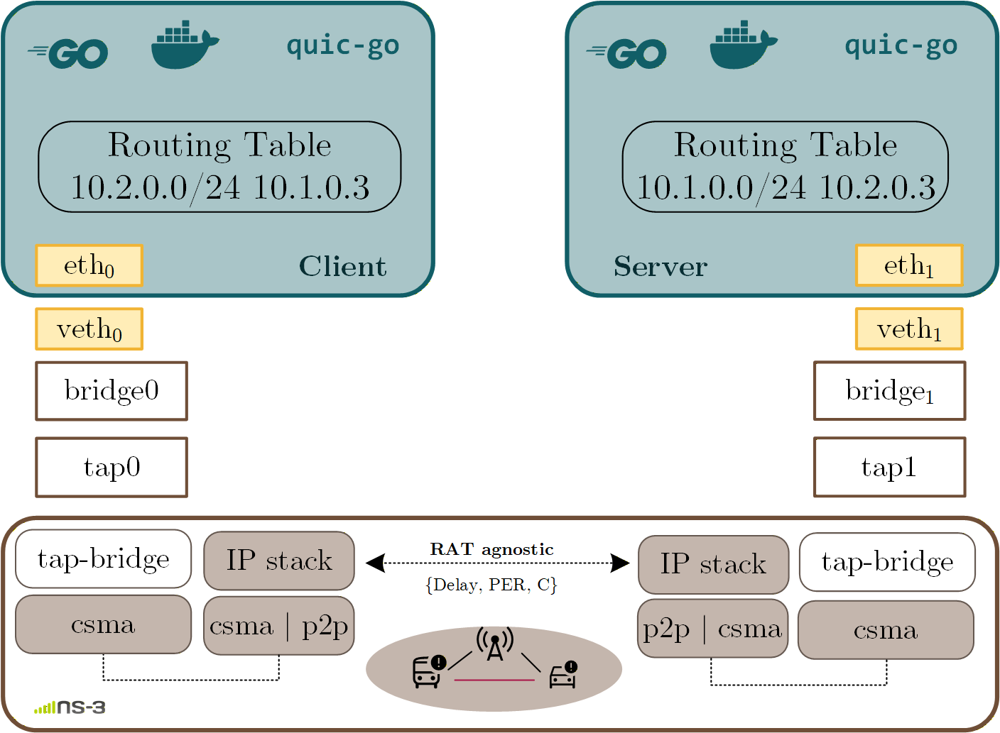

# Unveiling QUIC over V2X Communication

Practical repository for running QUIC-over-V2X experiments with a modified quic-go stack, traffic generators, and scenario utilities.

## Table of Contents

- [Overview](#overview)
- [Repository Layout](#repository-layout)
- [Requirements](#requirements)
- [Quick Start (Local Go Run)](#quick-start-local-go-run)
- [Configuration Files](#configuration-files)
- [Typical Outputs](#typical-outputs)
- [Plotting](#plotting)
- [References](#references)
- [Contact](#contact)

## Overview

This project provides:

- A modified QUIC implementation in [Quic_GO/](Quic_GO/), including custom scheduling logic.
- Go client/server apps in [Dockers/quic-apps/](Dockers/quic-apps/) to run QUIC or TCP traffic.
- Utilities for DSRC, 3GPP/C-V2X, and ns-3 based evaluations.

If you are new to the repository, start with the Quick Start section below and run one server/client experiment first.

## Repository Layout

- [Quic_GO/](Quic_GO/) - modified QUIC stack.
- [Dockers/](Dockers/) - docker assets, scenario scripts, and experiment orchestration.
- [Dockers/quic-apps/](Dockers/quic-apps/) - runnable Go applications and configs.
- [dsrc-utils/](dsrc-utils/) - DSRC scripts and traces.
- [3gpp-utils/](3gpp-utils/) - 3GPP/C-V2X support scripts.
- [ns-allinone-3.38/](ns-allinone-3.38/) - ns-3 environment.
- [plotting/](plotting/) - analysis notebooks.

## Requirements

- Go 1.19.13
- Linux environment (recommended for network tooling)
- OpenSSL (for certificate generation)
- Docker and Docker Compose
- Open5GS + OAI

Important:

- Keep Go pinned to 1.19.13 for compatibility with this codebase.
- Run server and client from their own folders so relative paths to certs and output files work.


## Building the ns-3 Environment

The simulations are based on ns-3.38.

To configure and build the simulation environment from the repository root:

```bash
cd ns-allinone-3.38/ns-3.38

./ns3 configure --enable-examples --enable-tests
./ns3 build
```


## Quick Start (Local Go Run)


### Install Go 1.19.13 and verify it:

If you don't have Go 1.19.13 installed:

```bash
cd /tmp
wget https://go.dev/dl/go1.19.13.linux-amd64.tar.gz  # For Linux
# or for macOS:
# wget https://go.dev/dl/go1.19.13.darwin-amd64.tar.gz

sudo rm -rf /usr/local/go
sudo tar -C /usr/local -xzf go1.19.13.linux-amd64.tar.gz
```

Update your PATH:

```bash
echo 'export PATH=$PATH:/usr/local/go/bin' >> ~/.bashrc
source ~/.bashrc
```

Verify installation:

```bash
go version  # Should show go version go1.19.13
```

### Step 3: Generate SSL/TLS Certificates

Navigate to the quic_apps directory and generate certificates:

```bash
cd quic_apps
chmod +x makecert.sh
./makecert.sh
```

Expected output includes `go1.19.13`.

### Running Apps in localhost as first step
#### 1) Optional kernel socket tuning (recommended)

```bash
sudo sysctl -w net.core.rmem_max=2500000
sudo sysctl -w net.core.rmem_default=2500000
```

#### 2) Build server and client

```bash
cd Dockers/quic-apps/go_server
go build server.go

cd ../go_client
go build client_OBU.go traffic_gen.go
```

#### 3) Run server (Terminal 1)

```bash
cd Dockers/quic-apps/go_server
./server docker-v2x-serv.json
```

#### 4) Run client (Terminal 2)

```bash
cd Dockers/quic-apps/go_client
./client_OBU docker-v2x-cli.json
```

If everything is correct, the server accepts sessions/streams and the client starts sending traffic.

## Configuration Files

Most experiments start from these two files:

- [Dockers/quic-apps/go_server/docker-v2x-serv.json](Dockers/quic-apps/go_server/docker-v2x-serv.json)
- [Dockers/quic-apps/go_client/docker-v2x-cli.json](Dockers/quic-apps/go_client/docker-v2x-cli.json)

Key fields:

- `Addr`: server address and port
- `Src`: source address and port
- `TCP`: `false` for QUIC, `true` for TCP
- `TotalSession`: number of sessions
- `TotalStream`: number of streams per session
- `InfoStream`: traffic model and per-stream size/distribution

Scheduler-related configuration files are available in both app folders as `conf_Scheduler.json`.

## Typical Outputs

During and after runs, look at:

- [Dockers/quic-apps/go_server/tmp/](Dockers/quic-apps/go_server/tmp/) - server-side logs
- [Dockers/quic-apps/go_client/tmp/](Dockers/quic-apps/go_client/tmp/) - client-side logs and metrics
- `key.log` files in server/client folders for TLS key logging workflows


## Experimental Scenarios

The repository supports three complementary evaluation environments for studying QUIC performance over V2X communication technologies. Each environment includes dedicated utilities and scripts to automate experiment execution, collect traces.

### 1. ns-3 Simulation Environment

The simulation environment is based on ns-3 and allows controlled evaluation of QUIC scheduling mechanisms under configurable network conditions.

**Location:** `ns-allinone-3.38/` and `Dockers/`

The simulation scripts and Docker configurations automate scenario execution, traffic generation, and result collection.

<p align="center">
  
</p>

### 2. DSRC Testbed

The DSRC experimental setup enables the evaluation of QUIC over IEEE 802.11p-based vehicular communication networks.

**Location:** `dsrc-utils/`

This directory contains the scripts and utilities required to automate testbed experiments, configure traffic generation, collect traces.

<p align="center">
  
</p>

### 3. 3GPP / C-V2X Testbed

The 3GPP testbed provides an experimental environment for evaluating QUIC over cellular V2X communications using 5G NR and the corresponding network infrastructure.

**Location:** `3gpp-utils/`

This directory contains the scripts and utilities for automating experiment execution, managing traffic generation, collecting experimental traces.

<p align="center">
  
</p>


##  Plotting

Jupyter notebooks have been included in the [plotting](/plotting/) folder to help the community reproduce figures, explore the results, and adapt the plotting utilities to their own work.


## References

- [QUIC Protocol RFC 9000](https://datatracker.ietf.org/doc/html/rfc9000)
- [quic-go](https://github.com/lucas-clemente/quic-go)
- [Open5GS Quickstart](https://open5gs.org/open5gs/docs/guide/01-quickstart/)
- [OpenAirInterface](https://openairinterface.org/)
- [ns-3](https://www.nsnam.org/documentation/)

## Contact

>> Fatima Khan Blanco: fatima.khan@unican.es

If you have any questions or need guidance during the installation process, don't hesitate to get in touch. I'm also open to collaborations, feel free to reach out!